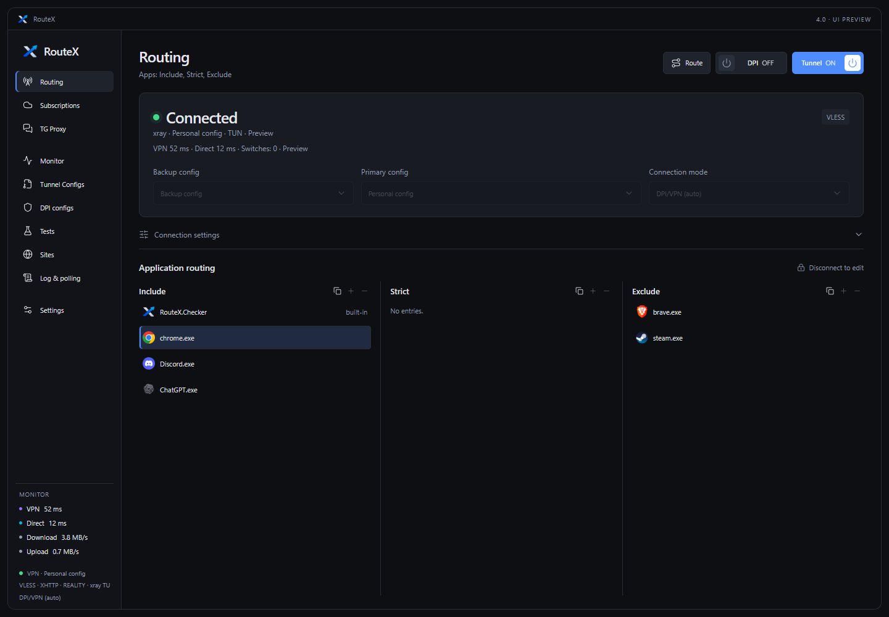
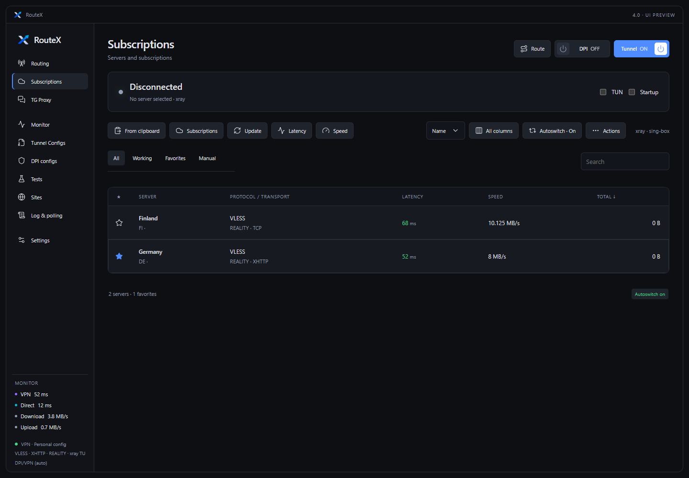
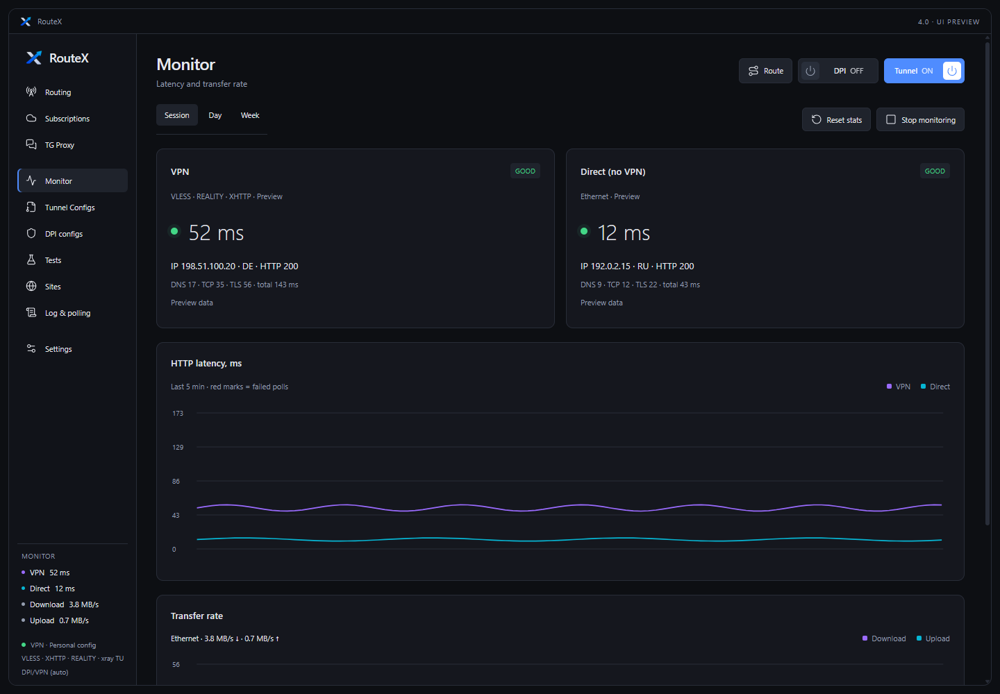
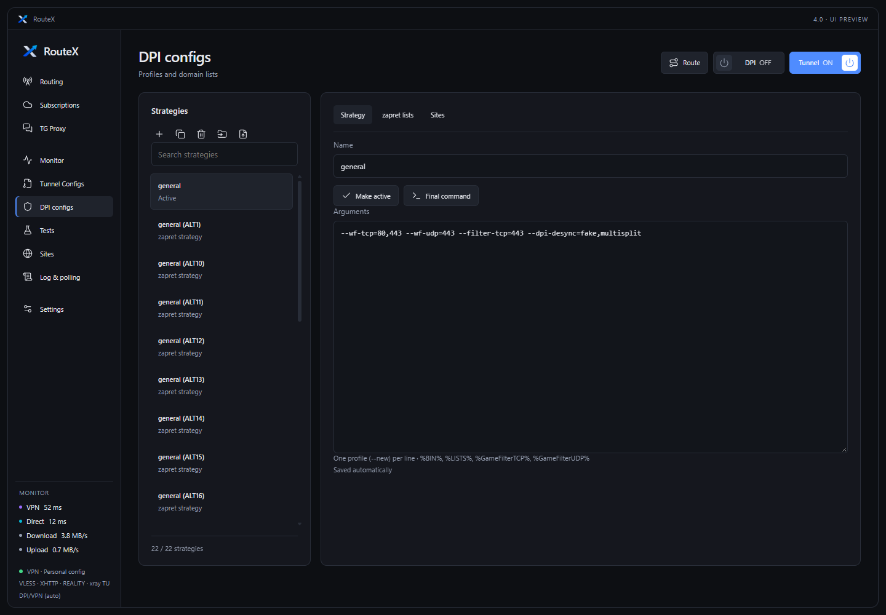
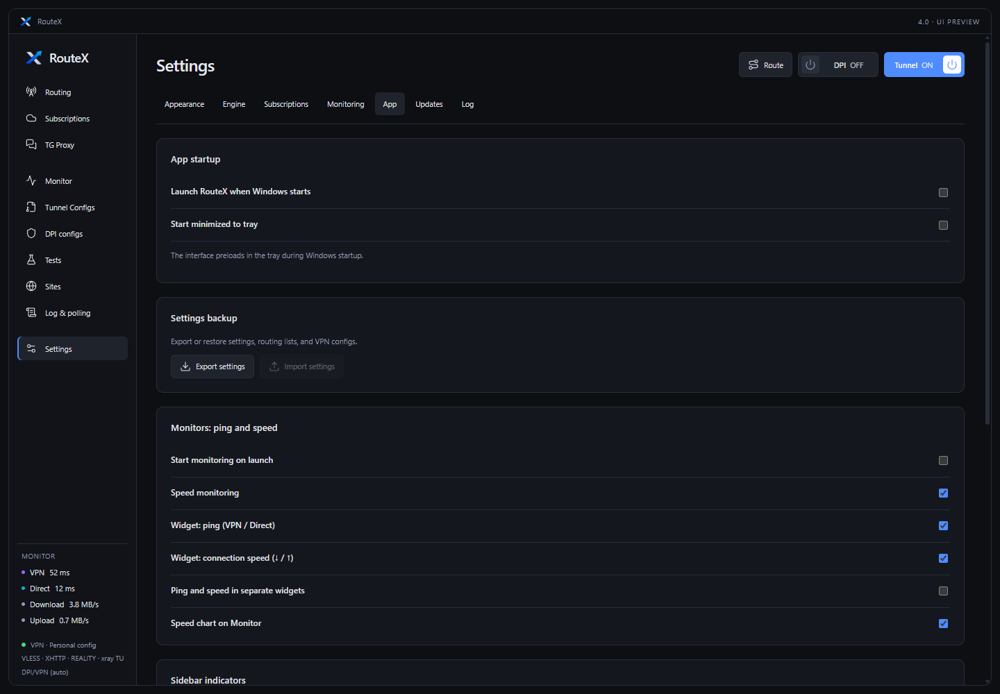
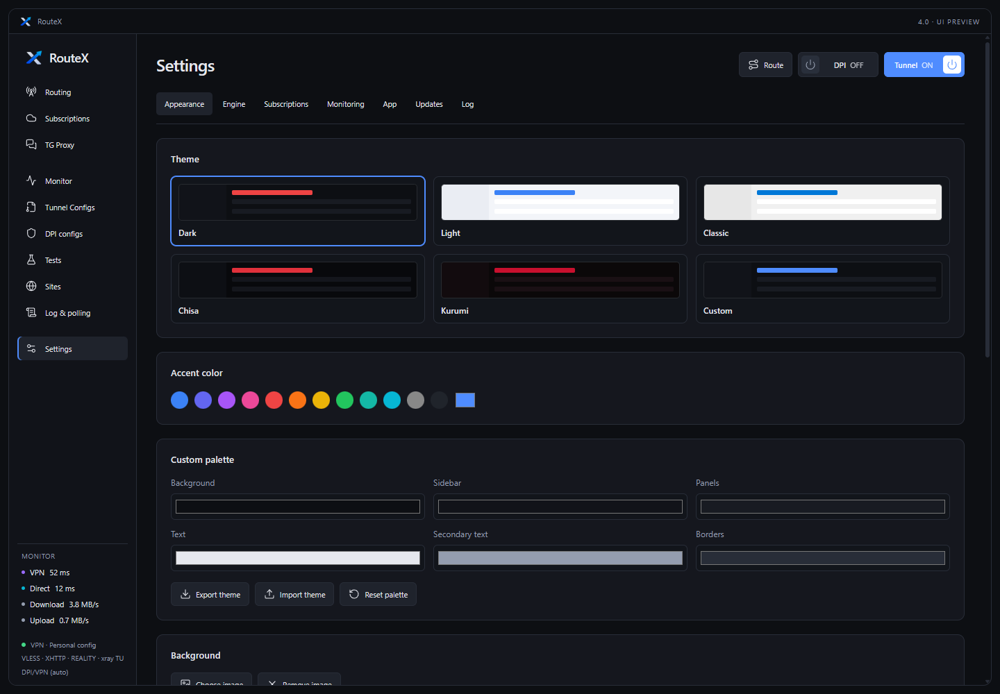
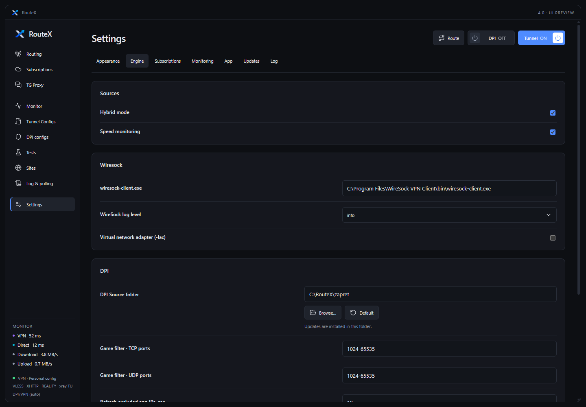
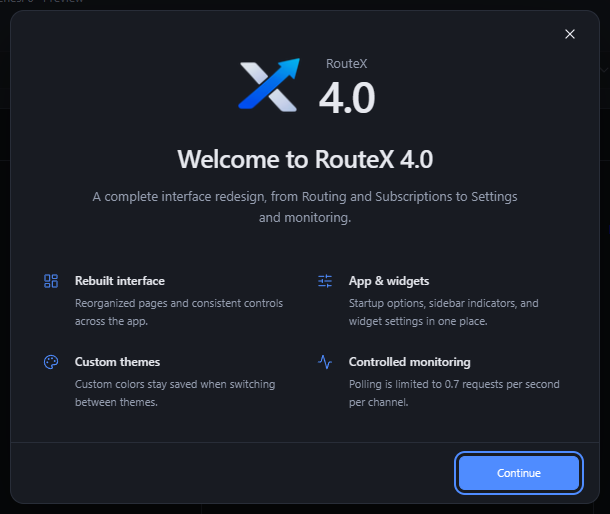

# RouteX

Secure connections and per-app routing for Windows, with automatic failover, DPI tools, subscriptions, and connection monitoring.

**[Download RouteX 4.0](https://github.com/WhereChixiaMeet/RouteX/releases/tag/v4.0)** · [Release notes](RELEASE-4.0.md)

## Interface

Screenshots use an isolated demo profile. Connection states and measurements are simulated, names and keys are examples, and displayed IP addresses belong to documentation ranges. Click an image to view it at full size.

| Routing | Subscriptions |
|:---:|:---:|
| <a href="docs/images/routex-4.0-routing.png"></a> | <a href="docs/images/routex-4.0-subscriptions.png"></a> |
| **Monitor** | **DPI configs** |
| <a href="docs/images/routex-4.0-monitor.png"></a> | <a href="docs/images/routex-4.0-dpi.png"></a> |
| **App settings** | **Appearance** |
| <a href="docs/images/routex-4.0-app.png"></a> | <a href="docs/images/routex-4.0-appearance.png"></a> |
| **Engine** | **What's new** |
| <a href="docs/images/routex-4.0-engine.png"></a> | <a href="docs/images/routex-4.0-welcome.png"></a> |

## Features

- WireGuard through WireSock; VLESS, VMess and Trojan through xray-core and sing-box TUN.
- Per-app, domain and IP routing with Include, Strict and Exclude lists. Drag entries and use the context menu while disconnected.
- Primary and backup configs, automatic failover, and RU sites direct routing.
- Subscriptions with latency and speed checks, favorites, traffic counters, and server autoswitch.
- DPI strategies and domain lists. Choose a custom DPI source folder; updates are installed there.
- Telegram proxy, connection tests, HTTP latency monitoring, throughput charts, and desktop widgets.
- Theme and accent-aware controls, custom palettes, fonts, backgrounds and Character images.
- Import and export of settings, configs, lists, subscriptions and Character images. Older settings backups remain supported; older backups cannot restore images they never included.

## Connection sources

- A config is available and no subscription server is available: use Primary config.
- A subscription server is available and no config is available: use subscriptions.
- Both sources are available, with Hybrid mode enabled: manual connection asks which source to use.
- Both sources are available, with Hybrid mode disabled: use Primary config; subscription connections are blocked. The explanation is shown once per installation and is retained across updates.

Hybrid mode is in **Settings → Engine → Sources**. RU sites direct, IPv4-only TUN, DNS controls and the TUN stack are also in Engine. Stack choices are `mixed` and `gvisor`; existing installations keep `mixed`. Disconnect before editing TUN settings and reconnect to apply them.

## Install or update

Download **RouteX.exe**, or fully extract **RouteX-4.0.zip** before starting it. Keep the existing `config`, core and theme folders when updating. The canonical application executable is RouteX.exe; data folder names and internal network identities remain compatible with earlier releases.

Requirements: Windows 10/11, .NET Framework 4.8, Microsoft Edge WebView2 Runtime, and administrator access for TUN, WinDivert and firewall operations. Connection and DPI cores can be installed or updated from the app. A separately installed WireSock engine is required for WireGuard configs.

```
RouteX.exe       main application
zapret\          default DPI source; a custom folder can be selected
xray\, singbox\  connection cores
config\          settings, tunnels, lists, strategies, themes and runtime data
log\             application logs
src\             source code and build scripts
```

## Monitoring

The latency chart measures HTTP request-to-first-byte time after connection setup; it is not ICMP ping. A failed probe is distinguished from a confirmed connection loss. Polling is capped at 0.7 requests per second per channel; alternates are tried on later scheduled probes instead of retry bursts.

## Build

Run `src\build.cmd` with a .NET SDK installed. The build targets .NET Framework 4.8, restores a pinned Microsoft WebView2 SDK from NuGet with SHA-256 verification, and embeds its managed UI libraries and native loaders. The Microsoft Edge WebView2 Runtime must be installed separately. Third-party license notices are in [docs/licenses](docs/licenses).

Older release and executable migration notes remain available in the repository history and release pages.
